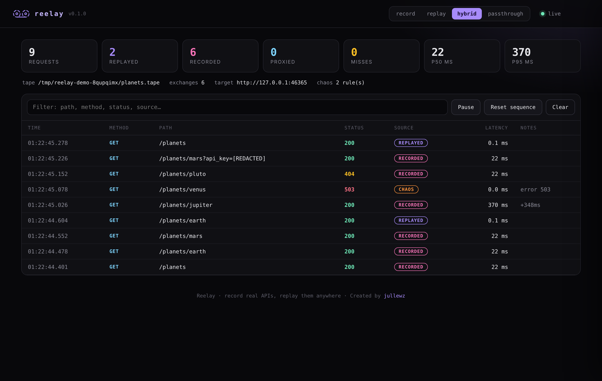
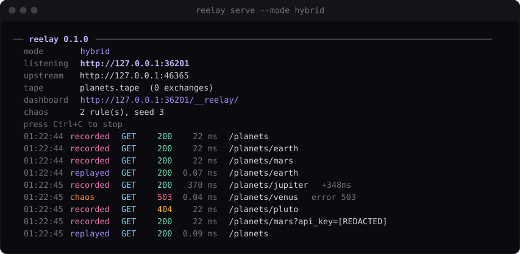
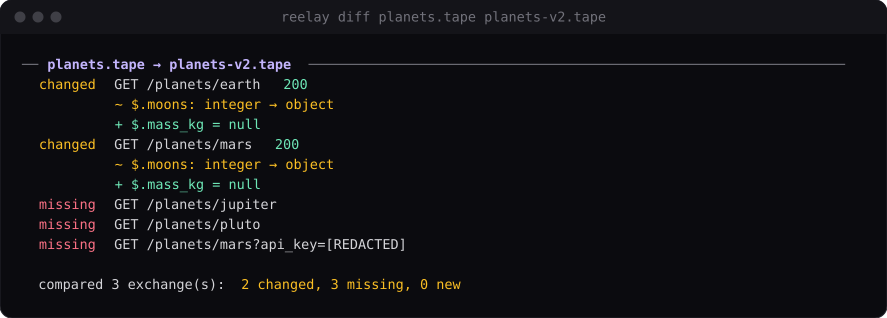

<div align="center">

# ◎◎ Reelay

**Record real HTTP API traffic. Replay it anywhere.**

A recording proxy, a mock server, a chaos lab and an API regression detector in one zero-dependency tool.

[](https://github.com/jullewz/reelay/actions/workflows/ci.yml)


[](LICENSE)



</div>

---

## Why Reelay

Tests that call real APIs are slow, flaky and need credentials. Hand-written mocks drift away from the real API
until they prove nothing. Reelay closes that gap:

1. **Record** real traffic once by pointing your app at Reelay instead of the API.
2. **Replay** it forever: offline, in CI, at sub-millisecond latency, with secrets already stripped.
3. **Break it on purpose** with latency, errors, dropped connections and bandwidth limits.
4. **Catch drift** by diffing tapes between API versions, or re-checking a tape against the live API.
5. **Document it** by generating an OpenAPI 3.1 spec from what the API actually returned.

Everything is a single Python package with **no runtime dependencies**, running on Linux, macOS and Windows 10+.

## Features

| Area | What you get |
|---|---|
| **Modes** | `record`, `replay`, `hybrid` (replay known, record new) and `passthrough`, switchable live from the dashboard |
| **Matching** | Method, path, query, body and selected headers. Ignore volatile query params and JSON fields by JSONPath. Strategies: `sequential` (perfect for polling), `cycle`, `first`, `last`. Optional fuzzy fallback |
| **Helpful misses** | A miss returns `501` with the closest recordings and *why* they differ: `query differs: page`, `body differs at $.user.id` |
| **Secret redaction** | Auth headers, cookies, token query params, password-like JSON keys, JWTs, AWS/GitHub/Slack/Stripe keys and private keys are removed **before** anything touches disk. Incoming requests are redacted the same way, so they still match |
| **Chaos** | Per-route latency (`250ms`, `100ms..400ms`, `normal(200ms,50ms)`), error injection, dropped connections, bandwidth throttling. Seeded and reproducible |
| **Templates** | `{{request.json.id}}`, `{{request.path.1}}`, `{{uuid}}`, `{{now}}`, `{{seq}}` in replayed responses, resolved from a whitelist, never `eval` |
| **Live dashboard** | Real-time traffic over server-sent events, request and response inspector, filters, stats, mode switch. No external assets |
| **Diff & verify** | Structural JSON diffs with JSONPath locations between two tapes, or between a tape and the live API (safe methods only by default) |
| **OpenAPI inference** | Path templating (`/users/42` → `/users/{userId}`), parameter types, JSON Schema 2020-12 for bodies, formats like `date-time`, `uuid`, `email` |
| **Interop** | HAR 1.2 import and export, tape filter, merge with dedupe, re-redaction |
| **Testing** | `with replay("api.tape") as api:` helper and a pytest plugin with a `reelay` fixture |

## See it work



Comparing two versions of an API, with volatile fields ignored:



Every image here comes from a real run. Regenerate them with `python scripts/make_demo.py`.

## Installation

Reelay needs **Python 3.11 or newer**.

```bash
git clone https://github.com/jullewz/reelay.git
cd reelay
python -m pip install .
# or, isolated:
pipx install git+https://github.com/jullewz/reelay.git
```

On **Windows 10/11** use the same commands in PowerShell (`py -m pip install .`). If the `reelay` command is not on
your `PATH`, run `py -m reelay`.

## Quick start

```bash
# 1. record: point your app at http://127.0.0.1:8080 instead of the real API
reelay record --target https://api.github.com --tape tapes/github.tape

curl http://127.0.0.1:8080/users/octocat        # forwarded, recorded, secrets stripped

# 2. replay: no network, no credentials, same answers
reelay replay --tape tapes/github.tape

# 3. open the live dashboard
#    http://127.0.0.1:8080/__reelay/
```

Every response carries an `X-Reelay` header (`recorded`, `replayed`, `proxied`, `miss`, `chaos`), so you always know
where an answer came from.

## Usage

```bash
# serving
reelay serve --mode hybrid --target https://api.example.com --tape api.tape   # replay known, record new
reelay replay --tape api.tape --on-miss proxy --target https://api.example.com
reelay replay --tape api.tape --fuzzy --strategy cycle --cors
reelay serve --chaos --seed 7                                  # enable [[chaos.rule]] from reelay.toml

# inspecting tapes
reelay ls api.tape --include 'GET /users/*'
reelay show api.tape 01JD3K
reelay stats api.tape

# catching API drift
reelay diff v1.tape v2.tape --ignore '$..updated_at'           # exit code 1 when they differ
reelay verify api.tape --target https://staging.example.com -f markdown -o drift.md

# generating docs
reelay infer api.tape -o openapi.yaml --title "Example API"

# tape housekeeping
reelay har-import session.har -o api.tape                      # from browser devtools
reelay har-export api.tape -o api.har
reelay filter api.tape -o users.tape -i 'GET /users/**' -x '/health'
reelay merge a.tape b.tape -o all.tape --dedupe
reelay redact api.tape                                          # re-apply rules, keeps a .bak
```

### In your tests

```python
from reelay.testing import replay


def test_profile():
    with replay("tests/tapes/github.tape") as api:
        user = GitHubClient(base_url=api.url).user("octocat")
        assert user.name == "The Octocat"
```

With pytest, the plugin loads automatically:

```python
import pytest


@pytest.mark.reelay(tape="tests/tapes/github.tape", target="https://api.github.com")
def test_profile(reelay):
    assert GitHubClient(base_url=reelay.url).user("octocat").name == "The Octocat"
```

Run `pytest --reelay-record` once to record missing exchanges, then commit the tape. Every later run is offline.

### Exit codes

| Code | Meaning |
|---|---|
| `0` | Success, or no differences |
| `1` | `diff` / `verify` found differences |
| `2` | Usage, configuration or tape error |
| `4` | Internal error |

## Configuration

Everything works from flags, and `reelay init` writes a commented `reelay.toml` for repeatable setups:

```toml
[server]
mode = "hybrid"
tape = "tapes/api.tape"
target = "https://api.example.com"

[match]
ignore_query = ["_", "cacheBuster"]
ignore_body = ["$.requestId", "$..timestamp"]
strategy = "sequential"

[redact]
headers = ["X-Internal-Token"]
json_keys = ["ssn"]

[[chaos.rule]]
route = "GET /search/**"
latency = "100ms..600ms"
error_rate = 0.05

[diff]
ignore = ["$..updated_at"]
```

Full reference: [docs/configuration.md](docs/configuration.md). Unknown keys are rejected with a suggestion.

## Architecture

```
  client ──▶ ┌──────────────── Reelay ────────────────┐ ──▶ upstream API
             │  HTTP/1.1 handler (keep-alive, chunked) │
             │        │                                │
             │   chaos engine ─▶ mode router           │
             │        │           │        │           │
             │   redactor ──▶ matcher   upstream client│
             │        │           │        │           │
             │      tape (JSONL, append-only, atomic)  │
             │        │                                │
             │   event bus ─▶ SSE dashboard · terminal │
             └─────────────────────────────────────────┘
   offline:  diff · verify · infer (OpenAPI) · HAR · filter · merge
```

| Module | Responsibility |
|---|---|
| `server.py` | HTTP layer, mode routing, control API, SSE |
| `matching.py` | Canonical request keys, strategies, miss explanations |
| `redact.py` | Secret removal for headers, query, JSON, forms and free text |
| `tape.py` | JSON Lines storage with crash-safe appends and atomic rewrites |
| `upstream.py` | Forwarding with hop-by-hop handling and content decoding |
| `chaos.py`, `templating.py` | Fault injection, dynamic responses |
| `jsonpath.py`, `jsondiff.py` | Safe JSONPath subset, structural diffs |
| `schema.py`, `openapi.py`, `yamlout.py` | JSON Schema and OpenAPI inference, YAML output |
| `compare.py`, `tapeops.py`, `har.py` | Diff/verify, tape operations, HAR |

More in [docs/architecture.md](docs/architecture.md). The tape format is specified in
[docs/tape-format.md](docs/tape-format.md).

## Security

- Binds to `127.0.0.1` by default and warns when exposed on other addresses.
- Secrets are redacted before writing tapes, in the dashboard and in the terminal log.
- Mutating control endpoints require an `X-Reelay-Control` header, which blocks cross-site requests from browsers.
- Templates resolve from a fixed whitelist. Nothing from a tape or request is ever executed.

Details and limits: [docs/security.md](docs/security.md) and [SECURITY.md](SECURITY.md).

## Development

```bash
git clone https://github.com/jullewz/reelay.git && cd reelay
python -m venv .venv && source .venv/bin/activate      # Windows: .venv\Scripts\Activate.ps1
python -m pip install -e ".[dev]"
```

## Testing

```bash
python -m pytest            # 128 tests: unit, real-socket integration, CLI subprocesses
ruff check . && ruff format --check .
mypy                        # strict
```

CI runs on Ubuntu, macOS and Windows with Python 3.11, 3.12 and 3.13.

## Roadmap

- [ ] HTTPS interception mode with a locally generated CA (forward-proxy style)
- [ ] WebSocket and server-sent event recording
- [ ] gRPC / HTTP/2 support
- [ ] Record scrubbing UI: edit and template exchanges from the dashboard
- [ ] Contract test generation from inferred schemas
- [ ] Signed PyPI releases

## Contributing

Contributions are welcome. See [CONTRIBUTING.md](CONTRIBUTING.md) and [CODE_OF_CONDUCT.md](CODE_OF_CONDUCT.md).

## License

[MIT](LICENSE). Copyright © 2026 jullewz.

## Creator

**Reelay** is created by **[jullewz](https://github.com/jullewz)**.

Designed, developed and maintained by jullewz.
